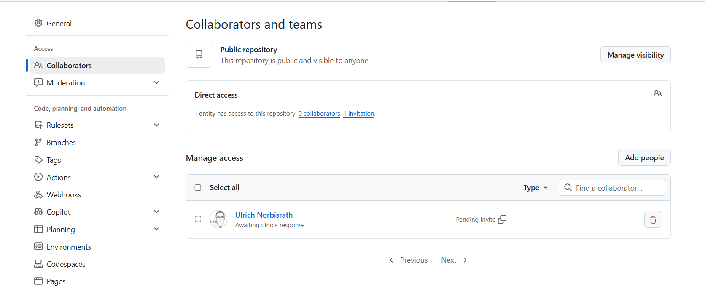

# Module 1 — Introduction and Local-First

Course workbook: [Module 1 — Introduction and Local-First](https://github.com/iotempire/iotempire-teaching/blob/main/full-classes/hsbi-databases-10d/modules/01-introduction-and-local-first.md)

**What I plan to explore:** <one line in your own words — e.g. what you want to build or learn in this class>

## Learning Goals

<a id="lg1"></a>
### LG1 — `class`

Explain how this class works — the CBL/PBL philosophy, the portfolio-based project work assessment, and the "moving bar" of a first-time course.

**Evidence:** [Personal profile](#task-personal-profile)

<a id="lg2"></a>
### LG2 — `portfolio`

Set up your personal GitHub portfolio from the course template, with a clean first commit and a `.gitignore` that keeps databases and secrets out of Git.

**Evidence:** [Task 1 — Portfolio](#task-1)

<a id="lg3"></a>
### LG3 — `toolchain`

Set up the entire toolchain reproducibly with uv — one fixed Python plus SQLite, DuckDB, Datasette, and more — on Windows, macOS, or Linux, and verify it.

**Evidence:** [Task 3 — Toolchain](#task-3)

<a id="lg4"></a>
### LG4 — `embedded`

Explain — with a measurement, not a slide — the difference between an embedded database and a client/server database, and why most local apps should not run a server.

**Evidence:** [Discovery](#task-discovery), [Task 6 — size and timings](#task-6)

<a id="lg5"></a>
### LG5 — `sqlite`

Load real rows into SQLite and query them from Python using bound parameters.

**Evidence:** [Task 4 — sqlite3 shell](#task-4), [Task 6 — telemetry](#task-6)

<a id="lg6"></a>
### LG6 — `verify-ai`

Take a first LLM-generated query, run it, and begin the habit that defines this course: verify before you trust.

**Evidence:** [Task 3 — what I verified](#task-3), [Task 7 — LLM query](#task-7)

<a id="task-personal-profile"></a>
## Personal profile

**Proves:** [LG1](#lg1)

My answers from the "Who are U?" round:

- Programming experience and languages:
- Prior SQL:
- Databases I have used:
- Python:
- Command line:
- Git / GitHub:
- Built a web app or run a server:
- **My expectations from this class:**

## My Task Pod

- <pod mate 1>, [portfolio](https://github.com/USERNAME/databases-portfolio)
- <pod mate 2>, [portfolio](https://github.com/USERNAME/databases-portfolio)

Links: [syllabus](https://github.com/iotempire/iotempire-teaching/blob/main/full-classes/hsbi-databases-10d/syllabus.md) · [this module in the workbook](https://github.com/iotempire/iotempire-teaching/blob/main/full-classes/hsbi-databases-10d/modules/01-introduction-and-local-first.md) · [my reflection](../Reflections/ref01.md)

<a id="task-discovery"></a>
## Discovery — Embedded vs. Client/Server

**Proves:** [LG4](#lg4)

_Our pod's own brainstorm before the reveal:_

| | Embedded | Client/server |
|---|---|---|
| Our name for it | | |
| Advantage | | |
| Cost | | |
| Example engines | | |

What our jigsaw found that the instructor's table missed:

<a id="task-1"></a>
## Task 1 — Portfolio

**Proves:** [LG2](#lg2)

- Repository created from [iotempire/iot-portfolio-template](https://github.com/iotempire/iot-portfolio-template) with **Use this template** (not a fork), so it starts with one clean commit and no upstream link.
- Cloned with `gh repo clone`, signed in over HTTPS with `gh auth login` (no SSH keys).
- The template had **no `.gitignore`**, so I added one: [`.gitignore`](../.gitignore). Besides the required entries, it also ignores SQLite's `-wal`/`-shm` side files and `*.sqlite`/`*.sqlite3`.
- Instructor [@ulno](https://github.com/ulno) invited as collaborator (write access) on 2026-10-28.

  

<a id="task-2"></a>
## Task 2 — Git & Markdown

**Proves:** [LG2](#lg2)

Small commits, each saying what changed — see the [commit history](https://github.com/AliAlRubaye12/databases-portfolio/commits/main).

Who did what in our pod:

<a id="task-3"></a>
## Task 3 — Toolchain with uv

**Proves:** [LG3](#lg3), [LG6](#lg6)

Installed on Windows 10 with winget: `gh`, `uv`, `sqlite3`. Tools via `uv tool install`: `litecli`, `datasette`, `sqlite-utils`.
The project pins Python in [`.python-version`](../.python-version) and locks every library in [`uv.lock`](../uv.lock).

Output of `uv run uv-check.py` ([script](../uv-check.py)):

```text
uv-managed Python: C:\Users\ali\Downloads\zash\databases-portfolio\.venv\Scripts\python.exe
python             3.14.10
sqlite (stdlib)    3.53.1
duckdb             2.0.0
datasette          0.65.5
sqlite-utils       4.2.1
pydantic           2.14.1
sqlalchemy         2.1.6
```

Command-line `sqlite3 --version`: `3.53.4`.

**What went wrong and how I verified the fix:**

- uv's default was the newest Python, **3.15**. `datasette` depends on `pyyaml`, which had no prebuilt Windows wheel for 3.15, so uv tried to compile it and failed (*"Microsoft Visual C++ 14.0 or greater is required"*). This is exactly the case the workbook warns about.
- Fix: `uv python install 3.14`, then `uv init --python 3.14` and `uv python pin 3.14`. With 3.14 every package installed from a prebuilt wheel.
- Versions differ slightly from the ones the course was tested with (for example `duckdb 2.0.0` instead of `1.5.6`), because `uv add` takes the newest compatible release. `uv.lock` records the exact versions, so a reviewer gets the same environment.

<a id="task-4"></a>
## Task 4 — The sqlite3 shell

**Proves:** [LG5](#lg5)

I kept the drill in a file, [`tour-commands.sql`](tour-commands.sql), and replayed it with
`sqlite3 Module01/tour.db ".read Module01/tour-commands.sql"`. That avoids the bracketed-paste problem completely.

- [`shell-tour.txt`](shell-tour.txt) — captured session: `.tables`, `.schema`, and a query under `.timer on`
- [`tour.sql`](tour.sql) — `.dump` of the throwaway `tour.db` (the `.db` itself is ignored by Git)

Most useful dot-command: <your sentence — e.g. `.output`, because …>

<a id="task-5"></a>
## Task 5 — SQL Island

See [sql-island.md](sql-island.md) _(to do: play the game and answer the questions)_.

<a id="task-6"></a>
## Task 6 — Telemetry in SQLite

**Proves:** [LG4](#lg4), [LG5](#lg5)

1. [`generate_telemetry.py`](generate_telemetry.py) writes `telemetry.csv`: 172,800 rows, 7.4 MB.
   The CSV is generated data, so `.gitignore` keeps it out of Git — anyone can rebuild it from the fixed seed.
2. [`load_telemetry.py`](load_telemetry.py) loads it with Python's built-in `sqlite3` and **bound parameters**
   (`INSERT INTO readings VALUES (?, ?, ?, ?, ?)`) — the values never become part of the SQL text.
3. The shop manager's questions are in [`queries.sql`](queries.sql); full output in [`telemetry-results.txt`](telemetry-results.txt).

| Question | Result | `.timer` real |
|---|---|---|
| Readings per machine | 57,600 each for cnc-01, cnc-02, cnc-03 | 0.082 s |
| Peak vibration | cnc-01 2.398 · **cnc-02 3.168** · cnc-03 2.550 | 0.101 s |
| Readings above the 2.0 mm/s alarm | 11,714 | 0.020 s |

**The "embedded, no server" claim in numbers:** `telemetry.db` is **10.0 MB** (10,526,720 bytes) for **172,800 rows**,
and every question is answered in about **0.1 s** on a laptop — no server process, no login, no network.
cnc-02 has the highest peak, which matches the bearing wear the generator simulates.

What would this cost in the cloud, and who pays? <your sentence>

<a id="task-7"></a>
## Task 7 — First LLM-generated query: run, profile, break

**Proves:** [LG6](#lg6)

**Model:** Claude (Opus 5.5), used as the coding assistant for this portfolio.

**Prompt** (from the workbook):

> Here is my SQLite table: `readings(ts TEXT, machine TEXT, temp_c REAL, vib_rms REAL, spindle_load REAL)`. Write a query that returns, for each machine, the average spindle load for readings taken overnight (after 18:00), ordered by average load descending.

**Generated SQL:**

```sql
SELECT machine, ROUND(AVG(spindle_load), 2) AS avg_load
FROM readings
WHERE time(ts) >= '18:00:00'
GROUP BY machine
ORDER BY avg_load DESC;
```

All checks are in [`llm-query.sql`](llm-query.sql); full output in [`llm-query-results.txt`](llm-query-results.txt).

**Run it** — it executes (0.055 s): cnc-03 60.43 · cnc-01 60.37 · cnc-02 60.36.

**Profile it** — `EXPLAIN QUERY PLAN`:

```text
|--SCAN readings
|--USE TEMP B-TREE FOR GROUP BY
`--USE TEMP B-TREE FOR ORDER BY
```

`SCAN readings` is a full-table scan: there is no index, and `time(ts)` wraps the column in a function, so even an index on `ts` could not be used as-is.

**Break it** — how many rows each version of "overnight" really keeps:

| Filter | Rows kept | Problem |
|---|---|---|
| `time(ts) >= '18:00:00'` (generated) | 43,200 | Only 18:00–23:59. "Overnight" usually continues **after midnight**, which this drops. |
| `time(ts) >= '18:00:00' OR time(ts) < '06:00:00'` | 86,400 | 18:00–06:00, the full night shift. |
| `ts > '2026-01-05 18:00:00'` (workbook example) | 129,597 | Correct string comparison, but it keeps **everything** after that moment, including all of the next day. |
| `ts LIKE '%18%'` (sloppy) | 18,102 | Wrong: it matches `2026-01-05 06:00:18` — any "18" anywhere in the timestamp. |

With the full 18:00–06:00 window the ranking **changes**: cnc-02 60.21 · cnc-03 60.20 · cnc-01 60.18.
All averages are within 0.25 of each other, so the ordering is mostly noise, not a real difference between machines.

**What the model got right, what it got wrong, and how I verified it:** <your paragraph, in your own words>

## Reflection 1

[Reflection 1](../Reflections/ref01.md)
