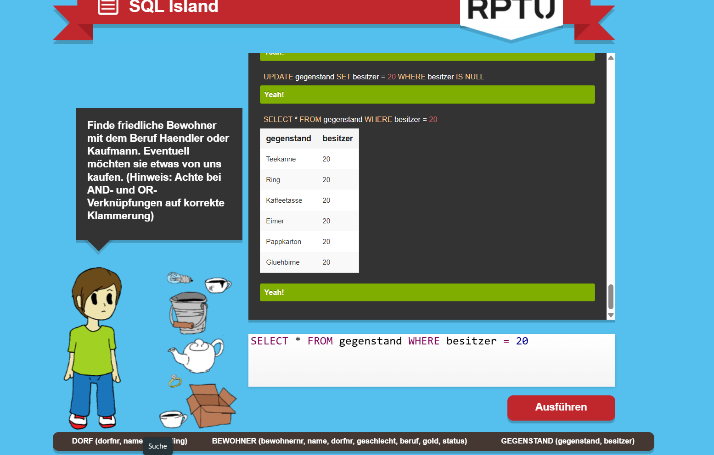
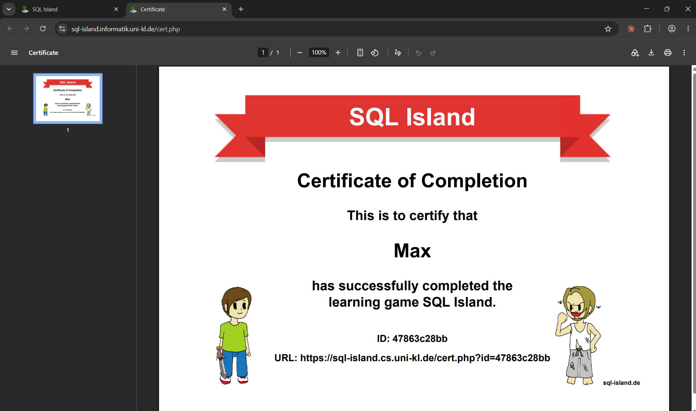

# SQL Island

Game: [SQL Island](https://sql-island.informatik.uni-kl.de/) (I played the German version). Back to [Module 1](README.md#task-5).

**Result: I finished the whole game** — [certificate](https://sql-island.cs.uni-kl.de/cert.php?id=47863c28bb) (ID `47863c28bb`, in-game name "Max").

## 1. What have I learned about databases and SQL so far, just by playing?

A database is a set of tables, and SQL is how you ask it questions.
You don't tell it *how* to find the data — you describe *what* you want, and it finds it.
You can also change the data (give an item to a person, add a new person), not just read it.

## 2. Which SQL commands and patterns did I actually use?

- `SELECT * FROM …` — show a whole table
- `WHERE` — only the rows I want, e.g. `WHERE besitzer = 20`
- `AND` / `OR` with brackets — e.g. *Haendler OR Kaufmann* **and** *friendly*; the game warns that the brackets matter
- `IS NULL` — find items with no owner
- `UPDATE … SET … WHERE …` — give all ownerless items to me: `UPDATE gegenstand SET besitzer = 20 WHERE besitzer IS NULL`
- `INSERT INTO` and `DELETE FROM` — add and remove rows
- linking two tables through a shared number (`dorfnr`, `besitzer` → `bewohnernr`)

## 3. In my own words: what is a table, a row, a column, and a query?

- **Table:** a list of one kind of thing, like `BEWOHNER` (the people).
- **Row:** one thing in that list — one person.
- **Column:** one fact about every thing — like `name` or `gold`.
- **Query:** a question to the database, like *"which items does person 20 own?"*

## 4. What surprised me? What is still confusing?

- **Surprised:** `UPDATE` without `WHERE` would change *every* row — one missing line can change the whole table.
- **Surprised:** `besitzer` is just a number that points at a person in another table. That is how tables are connected.
- **Still confusing:** how brackets change `AND` and `OR`. `A AND B OR C` is not the same as `A AND (B OR C)`.

## Progress screenshots

During the game — taking the ownerless items with `UPDATE … WHERE besitzer IS NULL`, then checking with `SELECT`:

At the end — the certificate:

