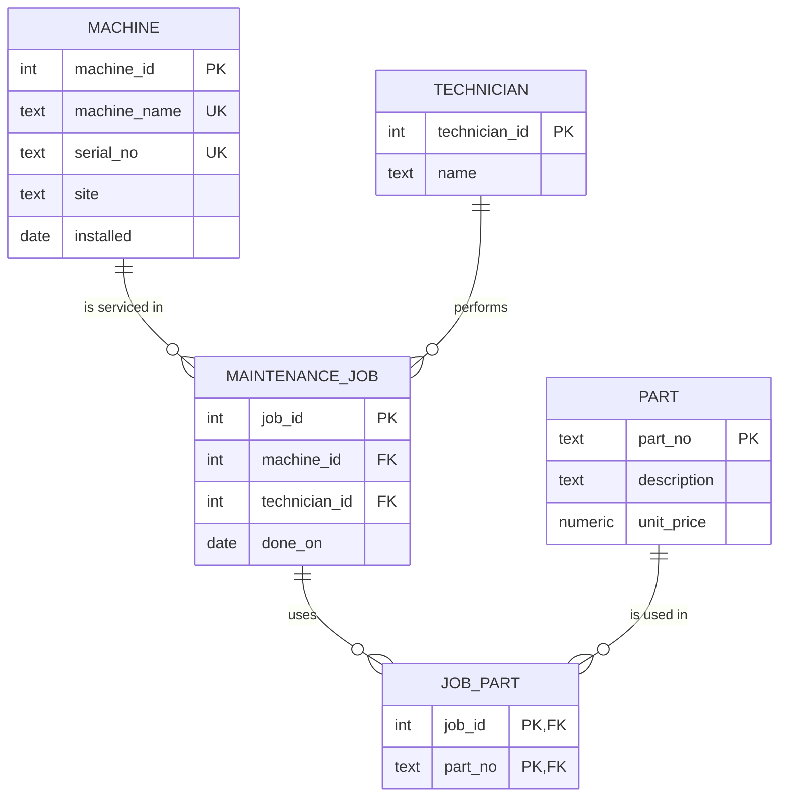

# ER Audit — the legacy maintenance database

Back to [Module 2](README.md#task-1). Database built with [`legacy-setup.sql`](legacy-setup.sql);
the count queries are in [`cardinality.sql`](cardinality.sql), full output in [`cardinality-results.txt`](cardinality-results.txt).

## 1. Entities, attributes, intended keys

| Entity | Attributes (legacy) | Intended primary key | Notes |
|---|---|---|---|
| **Machine** | `machine_name`, `serial_no`, `site`, `installed` | surrogate `machine_id`; `serial_no` as UNIQUE natural key | No PK declared. Names and serials are unique today (4 rows, 4 names, 4 serials), but nothing enforces it. |
| **Part** | `part_no`, `description`, `unit_price` | natural key `part_no` | Not declared UNIQUE — and it already isn't: 4 rows, only 3 distinct `part_no`. |
| **MaintenanceJob** | `job_id`, `machine_name`, `technician`, `done_on`, `parts_used` | `job_id` | `machine_name` should be a foreign key; `parts_used` hides a whole relationship. |
| **Technician** | _(only a name inside `maint_job`)_ | surrogate `technician_id` | Not a table at all. With a name as free text, "Beier" and "beier" would be two people. |
| **JobPart** (junction) | _(missing)_ | `(job_id, part_no)` | The table the m:n relationship needs; legacy squeezed it into `parts_used`. |

`site` could become its own entity too (two values: Gütersloh, Bielefeld), but with no further attributes it is fine as an attribute for now.

## 2. Reconstructed ER diagram

## 3. Cardinalities — proven with counts

| Relationship | Count query result | Cardinality |
|---|---|---|
| Machine → MaintenanceJob | cnc-01 has 2 jobs, cnc-02 has 1 (and orphan cnc-05 has 1) | **1 : n** |
| Technician → MaintenanceJob | Beier 2, Klaas 1, Werther 1 | **1 : n** |
| MaintenanceJob → Part | job 1 uses 2 parts, jobs 2 and 3 one each, job 4 none | a job has **0..n** parts |
| Part → MaintenanceJob | P-1001 is used by jobs 1 and 3 | a part is in **0..n** jobs |
| ⇒ MaintenanceJob ↔ Part | many on both sides | **m : n** → needs `job_part` |

For the "jobs per part" side I split the comma list with a recursive CTE (query C6) — the legacy schema
cannot answer that question without string surgery, which is itself evidence that the list is a hidden relationship.

## 4. What the legacy schema models, and what it hides

- **1:1** — not modelled at all. Machine and serial number are 1:1, but only as two columns in the same row; nothing stops two machines from sharing a serial.
- **1:n** — hidden. Machine→Job and Technician→Job exist only as matching text values, with no foreign key, so the database accepts a job for `cnc-05`, which does not exist.
- **m:n** — hidden inside a text column. `parts_used = 'P-1001,P-1002'` packs a whole junction table into one string and breaks 1NF.
