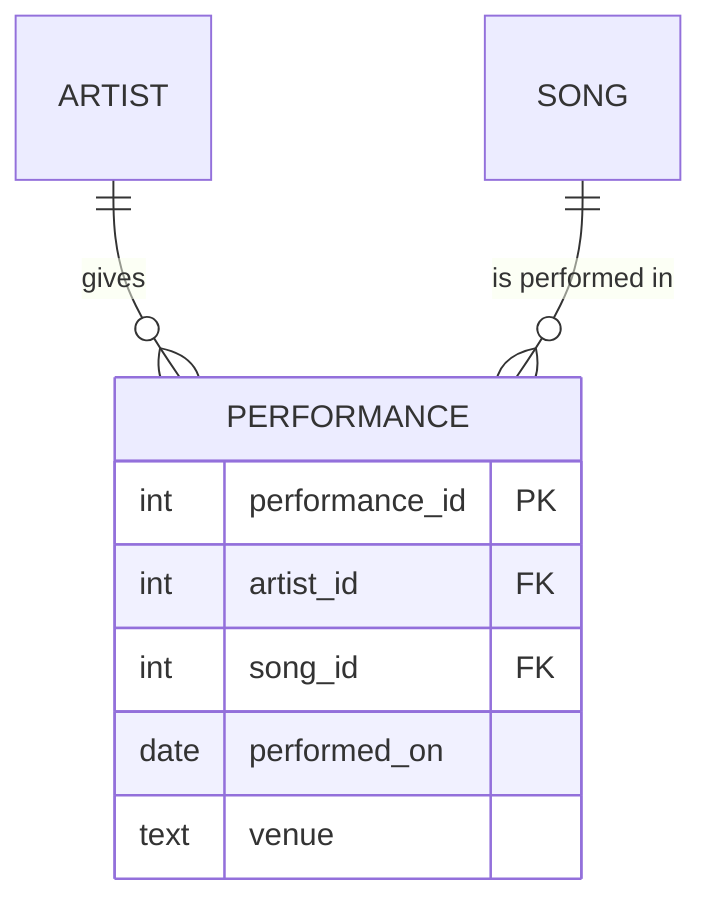
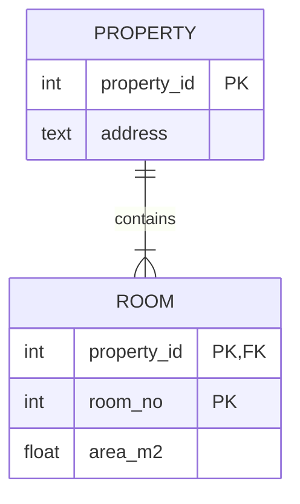
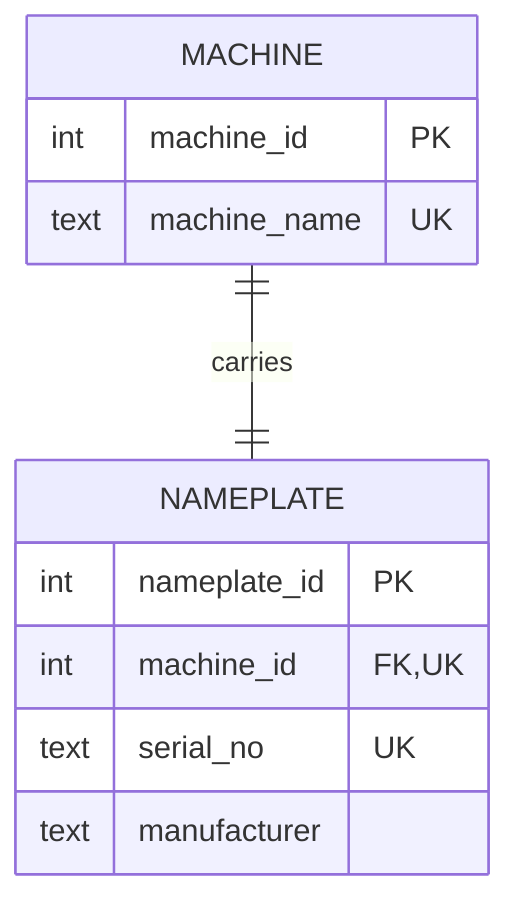
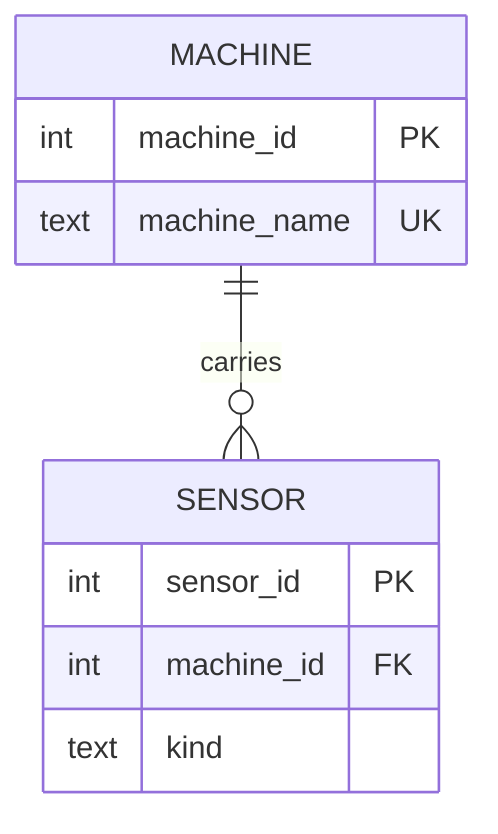
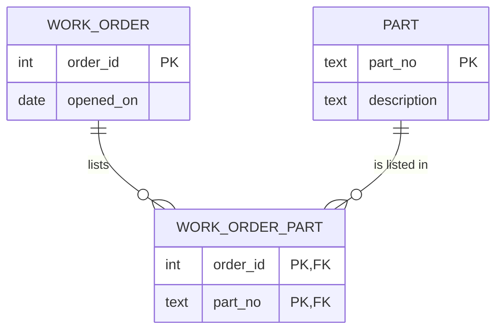
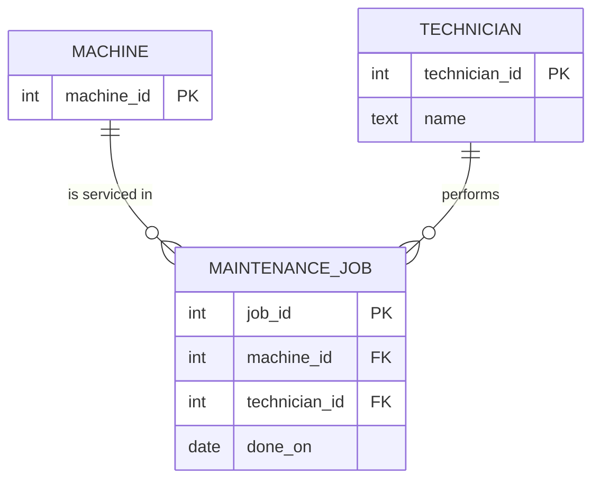
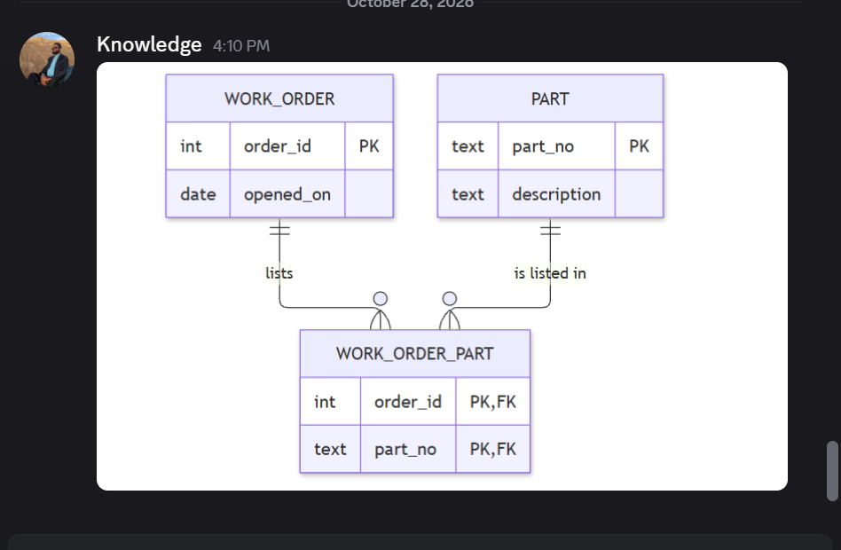

# Module 2 — Study log (Tasks A–C)

Back to [Module 2](README.md#task-a).

## References I used

| Source | The one concept I understood best from it |
|---|---|
| [Course workbook, Module 2](https://github.com/iotempire/iotempire-teaching/blob/main/full-classes/hsbi-databases-10d/modules/02-data-contracts-and-legacy-schemas.md) | Find the *real* cardinality by counting distinct values — `COUNT(*)` vs `COUNT(DISTINCT …)` beats any documentation. |
| [Wikipedia: Entity–relationship model](https://en.wikipedia.org/wiki/Entity%E2%80%93relationship_model) | Entities are nouns, relationships are verbs — and in crow's-foot notation a relationship cannot carry attributes, so it gets promoted to an entity. |
| [Wikipedia: Surrogate key](https://en.wikipedia.org/wiki/Surrogate_key) | A surrogate key does not replace the natural key: keep the natural key as a `UNIQUE` constraint, or the same real-world thing can be stored twice. |
| [SQLite: Foreign Key Support](https://sqlite.org/foreignkeys.html) | Foreign keys are off by default for backwards compatibility and must be switched on **per connection**; an index on the child column avoids full scans. |
| [Mermaid: Entity Relationship Diagrams](https://mermaid.js.org/syntax/entityRelationshipDiagram.html) | The cardinality markers (`\|\|`, `\|o`, `}o`, `}\|`) and the difference between an identifying (`--`) and a non-identifying (`..`) relationship. |

## Things I googled

- <term / question> — <what I found> — <URL>

## Remarkable things

- **Two defects combine.** In the legacy database, the duplicate `P-1003` row (a uniqueness defect) made job 2 appear twice in the parts join (a 1NF defect). One bad row corrupted a query that had nothing to do with duplicates. ([defects](README.md#task-2))
- **Text ordering is not number ordering.** `'9.90' < '15'` is false, because text is compared character by character and `'9'` comes after `'1'`.
- **SQLite does not enforce foreign keys by default.** `PRAGMA foreign_keys;` returns `0` — the declaration alone protects nothing until each connection turns it on. ([results](llm-verify-results.txt))
- **A name looked like a key until it was renamed.** Using `machine_name` as the key, renaming `cnc-01` turns 2 healthy jobs into orphans (orphans go from 1 to 3).
- **The workbook's own contract drops `machine_name`.** Verifying the contract against the legacy rows showed the name the shop actually uses would be lost in the migration.

## LLM Q&A

Model: Claude (Opus 5.5). Every answer was checked against `legacy.db` with [`llm-verify.sql`](llm-verify.sql) — output in [`llm-verify-results.txt`](llm-verify-results.txt) — or with the Task 1/2 queries.

| Prompt | Answer (summary) | How I verified it / where it was wrong |
|---|---|---|
| *"Here is a legacy schema: `<CREATE TABLEs>`. What entities, attributes, and relationships does it intend? What cardinalities are hidden, and how would I prove each with a COUNT?"* | Five entities (Machine, Part, MaintenanceJob, Technician, JobPart); Machine→Job and Technician→Job are 1:n, Job↔Part is m:n hidden in `parts_used`. Prove with `COUNT` per group on both sides. | Confirmed with [`cardinality.sql`](cardinality.sql): job 1 has 2 parts, P-1001 is in 2 jobs → m:n. **Wrong once:** the first write-up said job 4 "disappears" from the naive parts join — but job 4 has no parts, so it *should* be missing. Caught by re-reading the result, fixed. |
| *"Explain the difference between a natural key and a surrogate key, and give one real scenario where choosing the wrong one causes a data bug."* | A natural key is real-world data (serial, part number), a surrogate is a meaningless `INTEGER PRIMARY KEY`. Bug: key by machine *name*, rename the machine, and every job pointing at the old name is orphaned. | Simulated the rename in a rolled-back transaction: orphan jobs went from **1 to 3**. Claim holds. |
| *"A column holds `parts_used = 'P-1001,P-1002'`. Why does that violate 1NF, and what would the corrected schema look like?"* | 1NF needs one atomic value per cell; a list hides a relationship. Fix: a `job_part(job_id, part_no)` junction table with the pair as key. | `parts_used = 'P-1002'` returns **nothing**. `LIKE '%P-1002%'` finds job 1, but also matched a simulated part `P-10021` — a false positive. The junction table was proven in the [Task B proof](#proof-one-create-table--count). |
| *"Where exactly is the line between an entity and an attribute? Give a case where it is ambiguous, and say who decides."* | It becomes an entity when it has its own attributes, its own identity, or is shared and must stay consistent. Ambiguous example: `site`. The business decides, based on what it needs to record. | `site` has 2 values over 4 machines and no attributes of its own → an attribute is enough today. It would become an entity once sites need an address or a manager. |
| *"Why are SQLite foreign keys off by default?"* | Backwards compatibility: older databases were written without enforcement, so it must be enabled per connection with `PRAGMA foreign_keys = ON`. | `PRAGMA foreign_keys;` returned `0`. With it on, the [Task 3 check](check-legacy-results.txt) rejected a dangling `job_part` row. |

## My two best found ER sketches

### 1. Artist performs Song — when a relationship becomes an entity

Source: [Wikipedia, Entity–relationship model](https://en.wikipedia.org/wiki/Entity%E2%80%93relationship_model) — figure *"Two related entities shown using Crow's Foot notation"*. My redraw, including the step the article describes in its text:

**What it taught me that the others did not:** "performs" looks like a plain verb between two nouns, but as soon as it needs a date or a venue it has to become an entity (`PERFORMANCE`), because crow's-foot relationships cannot carry attributes.
That is exactly the reason `MAINTENANCE_JOB` in my [sketch 4](#4-entity-vs-attribute-vs-relationship--maintenance-job) is an entity and not just a line between machine and technician.

### 2. Property contains Room — an identifying relationship

Source: [Mermaid documentation, Entity Relationship Diagrams](https://mermaid.js.org/syntax/entityRelationshipDiagram.html) — the `PROPERTY ||--|{ ROOM : contains` example. My redraw with keys:

**What it taught me that the others did not:** a room cannot exist without its property, so the relationship is *identifying* (solid `--` line) and the parent's key becomes **part of the child's primary key** (`property_id, room_no`) — room 1 exists in every house.
It also uses `|{` (**one** or more) instead of `o{` (zero or more): a property must have at least one room, which none of my four sketches needed.

## Task B — From words to sketch

### 1. 1:1 — machine and nameplate

- The key can go on either side; put it on `nameplate.machine_id` **with `UNIQUE`** — without `UNIQUE` it silently becomes 1:n.
- **Entity or attribute?** The nameplate has no life of its own (it never moves to another machine), so in practice it is **attributes of the machine**: `serial_no` and `manufacturer` as columns on `machine`. A separate table is only worth it if nameplates are recorded separately, e.g. read in from a scanner before the machine exists.

### 2. 1:n — machine and sensors

The **"many" side holds the foreign key**: `sensor.machine_id NOT NULL`. A machine has 0..n sensors; a sensor is on exactly one machine.

### 3. m:n — work orders and parts

An extra **junction table** `work_order_part`. Its key is the pair `(order_id, part_no)` — that is exactly the rule *"an order can list a given part only once"*.

### 4. Entity vs. attribute vs. relationship — maintenance job

- **The job is an entity**, not just a relationship between machine and technician: the same technician can service the same machine many times, so the job needs its own identity (`job_id`), and parts attach to the *job*.
- **The technician is an entity**, not just a name: technicians perform many jobs, and a free-text name lets "Beier" and "beier" become two people.

### Proof: one `CREATE TABLE` + `COUNT`

My favourite is sketch 3 (m:n), because it is the one legacy schemas forget.
Script: [`cardinality-proof.sql`](cardinality-proof.sql) · output: [`cardinality-proof-results.txt`](cardinality-proof-results.txt)

| Check | Result |
|---|---|
| parts per order | order 1 → **2**, order 2 → 1 |
| orders per part | P-1001 → **2**, P-1002 → 1 |
| max on both sides | 2 and 2 → **many on both sides = m:n** |
| insert `(1, 'P-1001')` again | rejected — `UNIQUE constraint failed` (the pair key) |
| insert part `P-9999` | rejected — `FOREIGN KEY constraint failed` |

## Agreed learning (pod discussion)

**Image posted in our class Discord (2026-10-28):** the m:n junction table from [sketch 3](#3-mn--work-orders-and-parts).
We picked it because it is the relationship old databases forget: they hide it in a text list like `'P-1001,P-1002'`.

<!-- Task C: after talking with the neighbouring pod, add the 3–5 points you agreed on
     and any disagreement you left open. -->

- _(to add after the pod pairing)_
