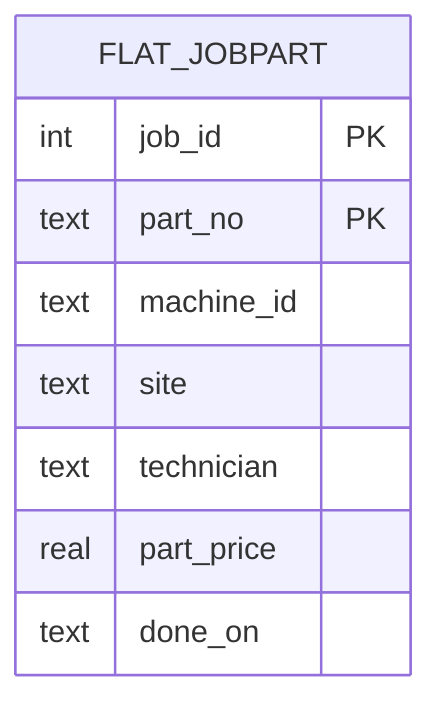
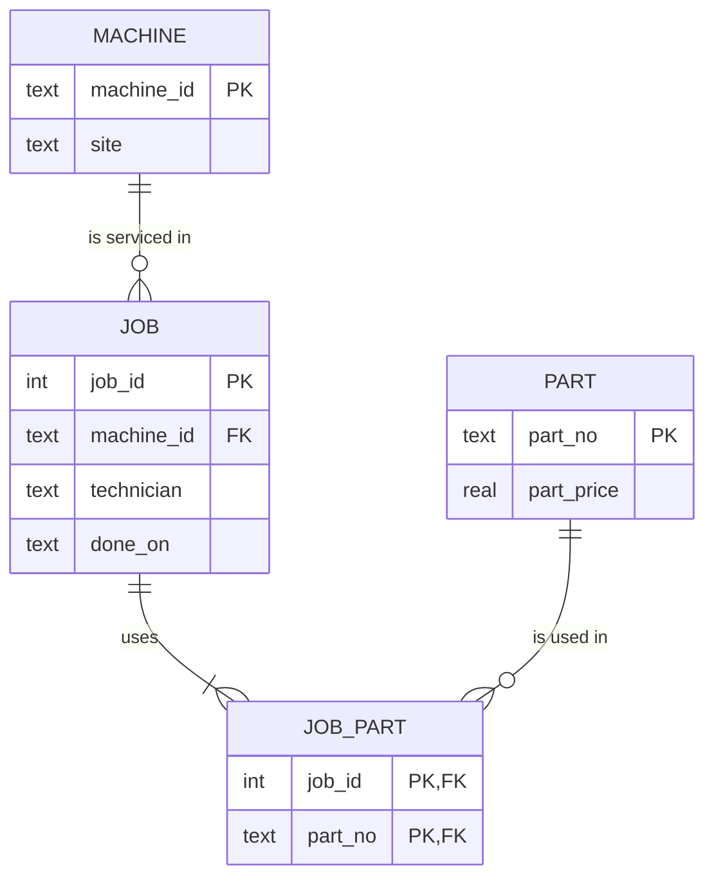

# Module 5 — Normalization notes

Back to [Module 5](README.md).

## Round 1 — See it: functional dependencies

Worked out with an AI assistant, then **tested with data** — [`fd_check.sql`](fd_check.sql), output in [`fd-check-results.txt`](fd-check-results.txt).
The test counts, for every value of X, how many different values of Y appear. 1 means the FD holds in that table.

| FD | domain fact or only observed? | 5 rows | 200,000 rows |
|---|---|---:|---:|
| `job_id → machine_id` | **domain** — a job happens on one machine | 1 | 1 |
| `job_id → technician` | **domain** — one technician per job | 1 | 1 |
| `machine_id → site` | **domain** — a machine stands in one place | 1 | 1 |
| `part_no → part_price` | **domain** — a part has one price | 1 | 1 |
| `technician → machine_id` | only observed (tech-0 happens to be on cnc-01) | 1 | **50** ❌ |
| `∅ → site` (every row is Gütersloh) | only observed | 1 | **2** ❌ |
| `part_price → part_no` | only observed — two parts *could* cost the same | 1 | 1 ⚠️ |
| `job_id → part_no` | not an FD — a job uses many parts | 2 | 10 |

**Candidate key:** `(job_id, part_no)` — unique in both tables, and neither column alone determines the rest.

**What I learned:** data can only **disprove** an FD, never prove one. `part_price → part_no` survives all 200,000 rows only because the generator gives each part its own price — it is still not a rule of the business.
The two accidents that *do* break on the big table (`technician → machine_id`, `∅ → site`) are exactly the kind an LLM promotes into a "dependency" when it only sees five rows.

### Two ER sketches

**As it is** — one flat table, every fact repeated per job–part row:

**As it should be** — 3NF:

**Which arrow disappears in the second one?** `job_id → site`. In the flat table, site hangs on every job row; in 3NF it only follows through `job → machine → site`, so it is stored once per machine.

## Round 2 — Break it: the three anomalies

[`round2.sql`](round2.sql) on the five rows · output: [`round2-results.txt`](round2-results.txt)

| anomaly | statement | what happened |
|---|---|---|
| **update** | `UPDATE flat5 SET site = 'Bielefeld' WHERE machine_id = 'cnc-01'` | touched **3 rows** for one fact. A second session that fixed only job 3 left cnc-01 in **two sites at once**: `Bielefeld,Gütersloh`. |
| **insert** | `INSERT INTO flat5(part_no, part_price) VALUES ('P-0004', 9.25)` | the new part can only exist as a half-empty fake row with `job_id = NULL`. |
| **delete** | `DELETE FROM flat5 WHERE job_id = 1` | the price of `P-0002` vanished — 0 rows still know it. |

## Curiosities (the harvest)

| curiosity | source |
|---|---|
| `part` has **10** rows, not 40: `k` only runs 1–10, so `(k % 40) + 1` gives `P-0002` … `P-0011`. | [`decompose-results.txt`](decompose-results.txt) |
| `printf('%.2f', …)` stores money as **text** — the 3NF `part` table has to `CAST` it back to `REAL`. | [`setup.sql`](setup.sql) |
| Python's built-in `sqlite3` caches prepared statements: an `EXPLAIN QUERY PLAN` run again after `DROP INDEX` still showed the **dropped index**. Fixed with `cached_statements=0`; a fresh `sqlite3` shell showed the real plan (`SCAN report_jobpart`). | [`race.py`](race.py) |
| The index on `report_jobpart` makes the dashboard **slower**: the planner walks the whole index and then fetches every row. | [`race-results.txt`](race-results.txt) |
| `report_wide` was not updated when cnc-02 moved — it still says Gütersloh. A forgotten copy is a wrong copy. | [`price-results.txt`](price-results.txt) |
| `SELECT DISTINCT` in the decomposition assumes one technician per job. The `job` primary key would reject the load if that were false — the decomposition checks the model. | [`decompose.sql`](decompose.sql) |
| DuckDB has no `date('...')` function — the query needed `DATE '2026-03-01'` instead. Same SQL is not always the same SQL. | [`duckdb_compare.py`](duckdb_compare.py) |

## Exchanges with the nearest pod

<!-- One line per round: what you showed, what the neighbour asked or found. -->

- _(to add after class)_
